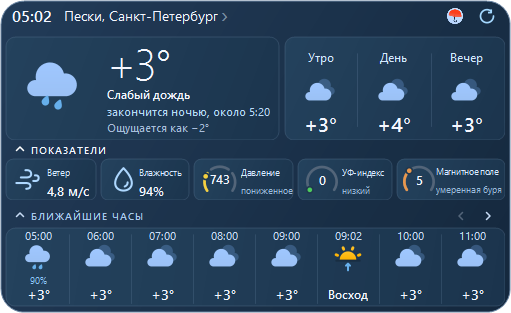

# Яндекс Погода

Погодный гаджет для рабочего стола Windows с GadgetPack. Показывает текущую погоду, показатели и почасовой прогноз Яндекс Погоды для сохранённых мест

Проект никак не связан с компанией «Яндекс»

## Быстрая установка

1. Установите GadgetPack, если его ещё нет [Скачать GadgetPack](https://gadgetpack.net/)
2. Скачайте пакет из последнего релиза [YandexWeather.gadget](https://github.com/amd64fox/yandex-weather-gadget/releases/latest/download/YandexWeather.gadget)
3. Откройте скачанный файл двойным щелчком и подтвердите установку
4. В **GadgetPack Tools → Add gadget…** добавьте «Яндекс Погода»
